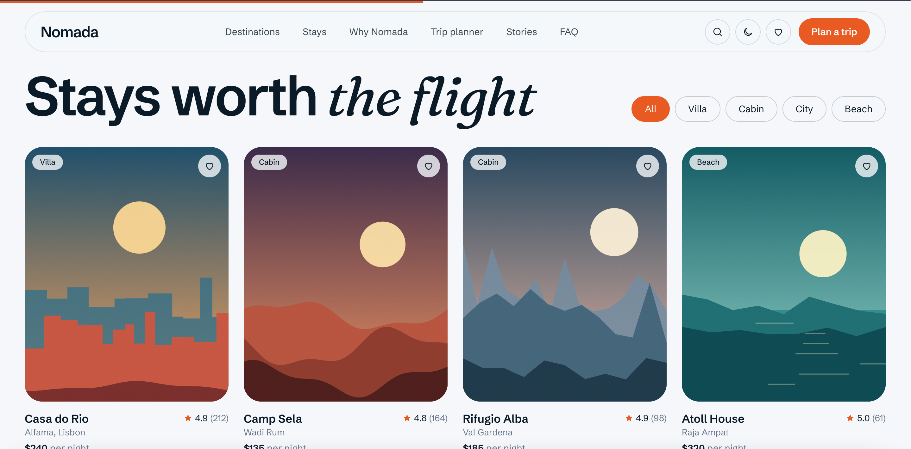

# Nomada

A travel and stays website template built with **Next.js 14 (App Router)**, **React 18**, **TypeScript**, **Tailwind CSS**, **GSAP (ScrollTrigger)**, **Three.js**, and **Lenis**.

All site content is centralized in a single configuration file, and visual scenes use SVG artwork out of the box with support for custom photography.

[Live Demo](https://nomada-plum.vercel.app/)



## Quick Start

Requires Node.js 18.17 or newer.

```bash
npm install
cp .env.example .env.local
npm run dev
